# SYN-BIOGENESIS-3D

**Biogenesis in three dimensions: a C11 artificial-life simulation grown
from Biogenesis 0.9 into a box of water.**

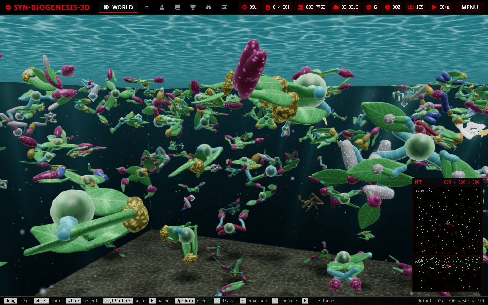

Organisms are bodies of coloured segments. Green ones photosynthesise, red
ones eat, white ones infect, gray ones kill, blue ones shield, cyan ones
swim and yellow ones bring more children, as in Biogenesis 0.9; purple
ones, from Color Mod 2.01, live on methane. They live in a box of water
rather than on a plane, and the water has a top and a bottom: light falls
from the surface and dims with depth, CO2 is dissolved in it cell by cell,
the dead sink and rot into methane, and every line keeps to a height of
its own. Bodies bend out of 0.9's plane, stand as disks, cones or orbs,
and tumble as rigid bodies.

It is not a port: no 3D original exists to match frame for frame. What
[SYN-BIOGENESIS](https://github.com/syn990/SYN-BIOGENESIS) proves against
0.9's Java program, this program proves against itself: the same seed
gives the same world with every build, and the carbon and energy books
balance on every frame. Every Biogenesis's beings come in, and every
feature of SYN-BIOGENESIS's SYN edition is here
([docs/PARITY.md](docs/PARITY.md)): the laboratory, the library, the
statistics and family tree, the arena, the telescope and Create a winner,
under the same SYN-OS interface.

| | | |
|---|---|---|
| 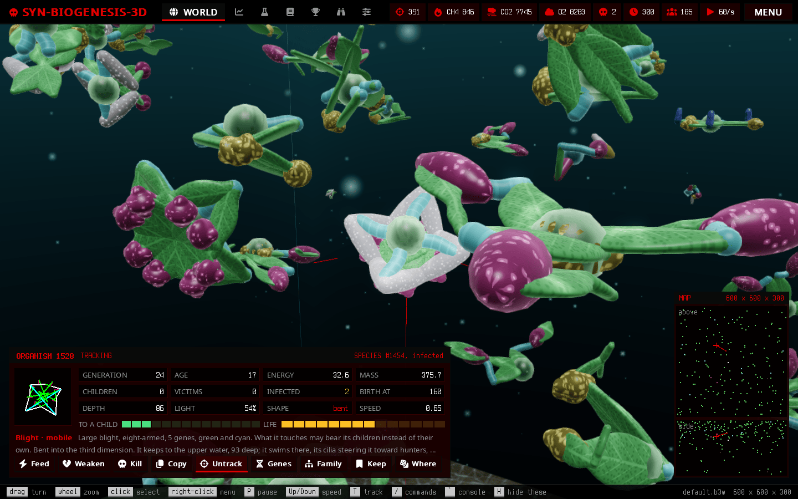 | 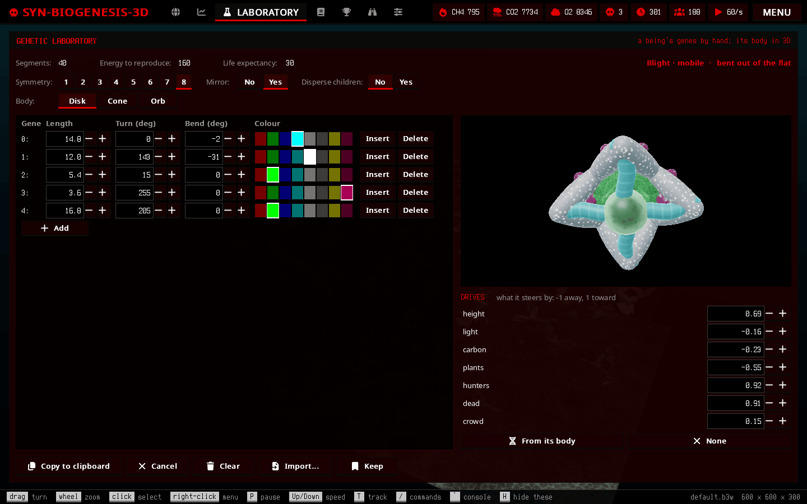 | 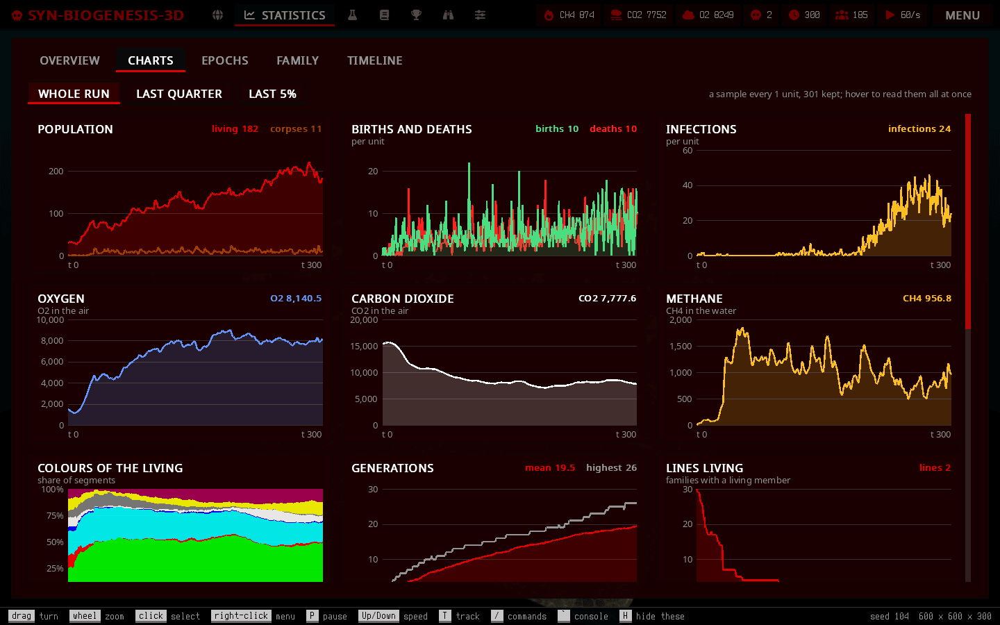 |
| An organism selected: a blight 86 deep, bent, its cilia steering it | The laboratory: its genes, their bends, its drives and its body | Statistics since genesis |

**Contents:** [The water](#the-water) ·
[Dimensional states](#dimensional-states) ·
[Divergence from the 2D](#divergence-from-the-2d) ·
[Example beings](#example-beings) ·
[Reading the charts](#reading-the-charts) ·
[The interface](#the-interface) · [Build and run](#build-and-run) ·
[Credits](#credits)

The rest of the story is in `docs`:
- [docs/DESIGN.md](docs/DESIGN.md): the plan, what is kept from 0.9 and
  every change with its reason;
- [docs/ecology](docs/ecology/README.md): who wins in the water, against
  the first rules (0.9's in a box), over 1,992 runs;
- [docs/sweep](docs/sweep/README.md): the first rules' study. 0.9's life
  coped with a third dimension only where the water was crowded, and
  plants owned the worlds. It is why the rules changed;
- [docs/crack](docs/crack/README.md): the dice telescope worked out again
  for this program's genesis, and the fit that weighs a founder;
- [docs/charts](docs/charts/tables.md): the numbers behind this page's
  charts (`tools/charts.py`).

## The water

| colour | in 0.9 | here |
|---|---|---|
| green | energy by its length and the CO2 in the air | by its length as seen from above (a level leaf all of it, an upright one none), times the light where it is, as the CO2 dissolved around it allows; leaves turn their body to lie level |
| red | eats what it touches, living or dead | the same |
| cyan | a random kick now and then | a steady stroke along the way the body is going, turning it to face there; random kicks with nowhere to go |
| blue | shields | the same |
| white | infects: the next child of what it touches is its own | the same |
| gray | kills what it touches | the same |
| yellow | more children a birth | the same |
| purple | (Color Mod's methane eater) | energy from the methane around it by its whole length, whatever the light |

The world is a box, 600 x 600 x 300 by default, the surface on top:
- light falls from the surface and dims by e every 250 units down
  (`light_depth`), and in the shade of the bodies above: the floor of the
  default box has 30% of the surface's;
- CO2 is dissolved in the water, cell by cell, and spreads slowly, so a
  crowded bed of plants starves and whatever breathes beside it feeds it.
  A bigger world holds more carbon, and more life;
- the dead sink, and rot into methane where they come to rest, so the
  deep water holds what purple segments live on, whatever the light; the
  methane turns slowly back into CO2. O2 + CO2 + CH4 is the world's
  carbon, checked every frame;
- every organism sees, by the light (from 120 away at the surface, 27
  three light depths down), and smells the dead in the dark. Six inherited
  drives (light, carbon, plants, hunters, the dead, company) pull it, the
  more the hungrier it is; what it shuns it shuns full or not;
- every line keeps to a height of its own, a gene from the floor to the
  surface: its cilia swim it there and its float takes a body without
  them;
- children bud off in any of 26 directions, and founders start at their
  line's height.

Days are an option (`set day_length 8`): life then sinks with the morning
and rises with the dusk, but the worlds are poorer for it (see
[the water](docs/DESIGN.md#the-water)), so they are off by default.

## Dimensional states

On a plane a body has one way to be. In the water a body, a line and a
world each have several.

### A body: flat or bent; a disk, a cone or an orb

| | | | |
|---|---|---|---|
| 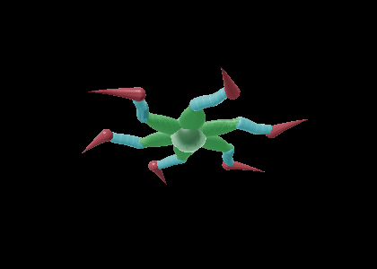 | 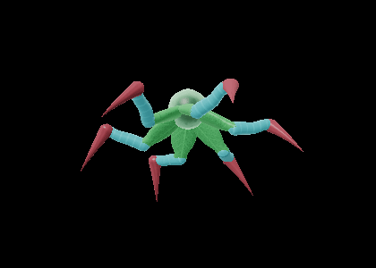 | 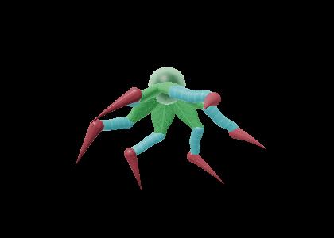 | 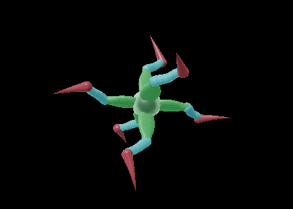 |
| **Flat disk:** every bend 0, a body exactly as 0.9 drew it | **Bent:** the same genes bent 34°, -40° and 29° out of the plane | **Cone:** the flat genes, each arm tilted 40° out of the disk | **Orb:** the flat genes, six arms on an octahedron |

The same three genes each time (a leaf 16 long, a cilium 11, a claw 13)
and six arms, in the laboratory, tilted to show them.
- **A gene** is a length, a turn and a colour, as in 0.9, and a bend
  (`pitch`): how far the segment bends up or down out of the plane its
  turn happens in. A new random gene bends half the time (`pitch_prob`),
  anywhere from straight down to straight up. A code whose every bend is 0
  is **flat**, and a flat disk is exactly 0.9's body, in a plane, as every
  0.9 being that comes in is (`make test` checks this against 0.9's own
  drawing for 400 random codes).
- **A body plan** stands the arms: as 0.9's **disk**, as a **cone** (each
  arm tilted out of the disk by the code's cone angle) or as an **orb**
  (spread over a sphere: two up and down, four a tetrahedron, six an
  octahedron, eight a cube). A quarter of new random codes are cones and a
  quarter orbs (`cone_prob`, `orb_prob`). A 0.9 code is a disk.
- **How it lies:** every body is a rigid body that turns about its centre
  of mass, keeps its angular momentum and tumbles. How level it lies is
  how near its up axis is to the world's: 1 level, 0 on its edge, 0.5 for
  a body turned at random. Leaves twist their body toward level, so a flat
  body can lie wholly level and a leaf on it catch all the light it has; a
  bent one cannot. Collisions and cilia tip bodies over.

<picture>
  <source media="(prefers-color-scheme: dark)" srcset="docs/charts/plans-dark.svg">
  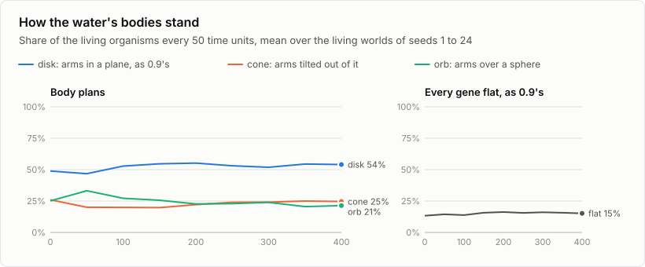
</picture>

In 24 worlds of the default box (seeds 1 to 24, to time 400):
- the founders are what the dice give: 49% disks, 26% cones, 25% orbs;
- by time 400 the disks hold 54% of the living, the cones 25% and the
  orbs 21%. Orbs thin a little and cones hold on, but no plan takes over:
  the shape of the arms matters less to a line than its colours, its
  height and the cost of its children (the telescope's fit says the same,
  [docs/crack](docs/crack/README.md#the-fitness-which-founders-bloodline-leads));
- flat codes stay at 13% to 16%, about what chance gives codes of the
  sizes that live (with half of new genes bending, a code of three genes
  is flat one time in eight). Thin water selects them (under the first
  rules, 97% of the living in a slab 4 deep were flat,
  [docs/sweep](docs/sweep/README.md#thin-water-selects-flat-bodies)); 300
  deep, it does not;
- bodies lie about as level as at random: 0.51 for the plants, 0.54 for
  the mixed and 0.49 for the hunters over times 300 to 400. Under the
  rules before body plans and steady swimming they lay at 0.59 to 0.67
  ([docs/ecology](docs/ecology/README.md#the-default-worlds)). Both are
  likely causes, since a cone or an orb cannot lie flat and cilia turn a
  body to face its way, but these runs do not part them.

### A line: its height

Every line keeps to a height of its own, a gene (`height`, 0 the floor, 1
the surface) drawn for founders, inherited and drawn anew by a mutation
(5%, as for every trait). Every living body is pulled toward it from a
fifth of the water off: cilia swim it there and a float takes a body
without them. The light drive no longer moves a body up or down; it steers
across, out of the shade or into it.

<picture>
  <source media="(prefers-color-scheme: dark)" srcset="docs/charts/depth-dark.svg">
  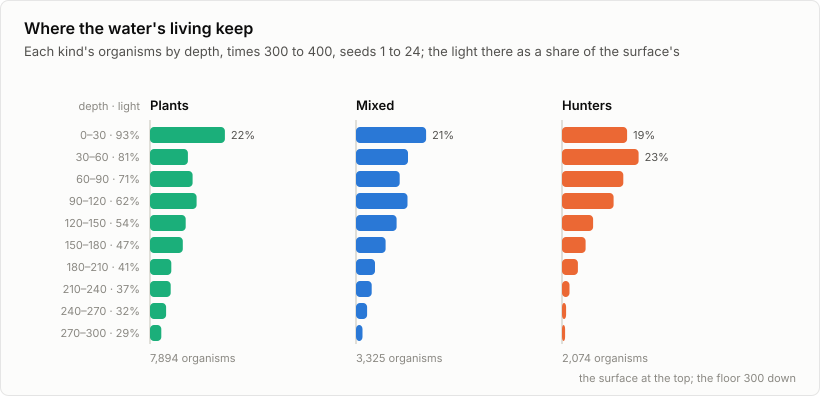
</picture>

Over times 300 to 400 in the same 24 worlds:
- the light falls from 93% of the surface's in the top 30 units to 29% in
  the lowest 30, shade included;
- the plants live at every height: 22% in the top band, then 10% to 14% a
  band down to 180, thinning to 3% at the floor. Each line keeps where its
  height gene puts it, and the dim water is a lineage's choice rather than
  a place it is stuck;
- the hunters keep high: 60% of them within 90 units of the surface, and
  4% below 210. Sight needs light, so prey is seen furthest near the
  surface (120 units away there, 73 a light depth down);
- the mixed, green bodies with teeth, lie between.

The organism's card gives its depth and the light it has, and the
statistics chart where the leaves and the hunters live
([Reading the charts](#reading-the-charts)).

### A world: its shape

| | | |
|---|---|---|
| 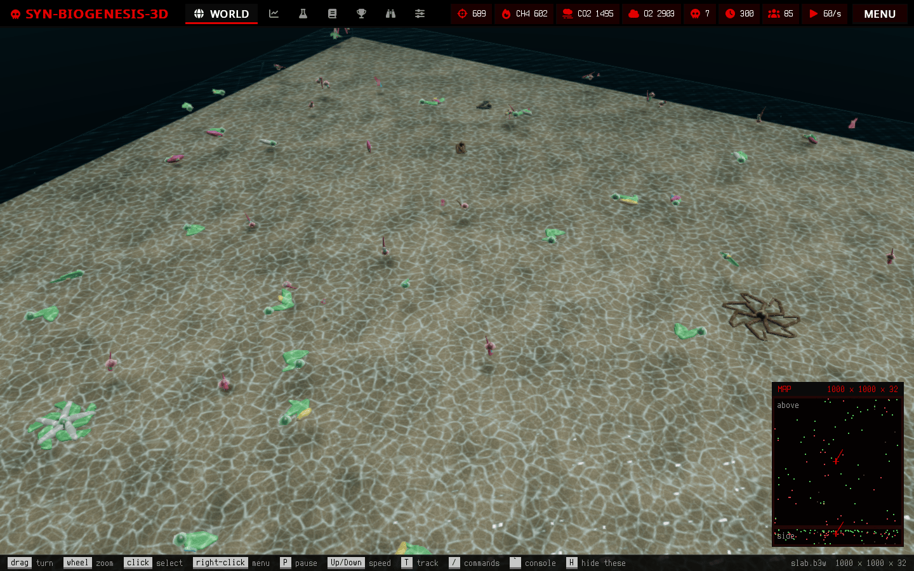 | 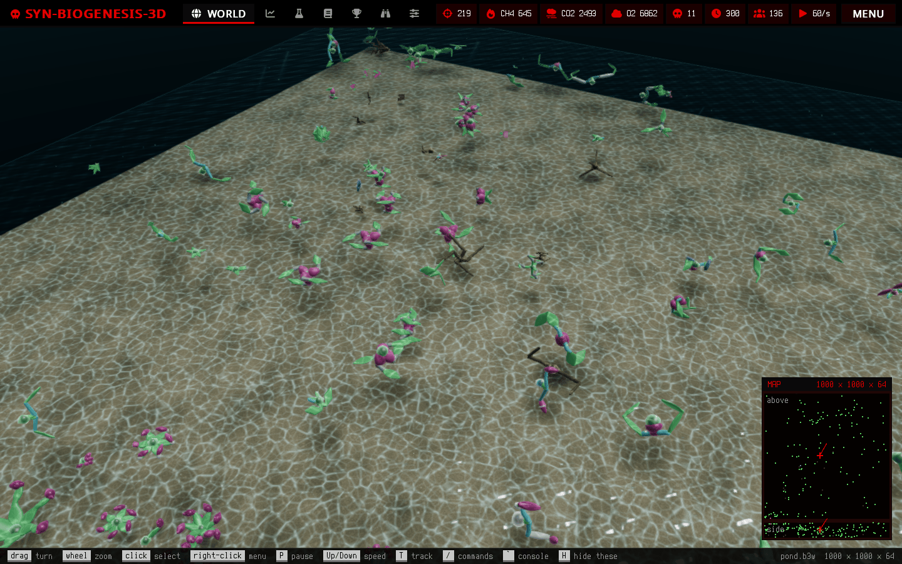 | 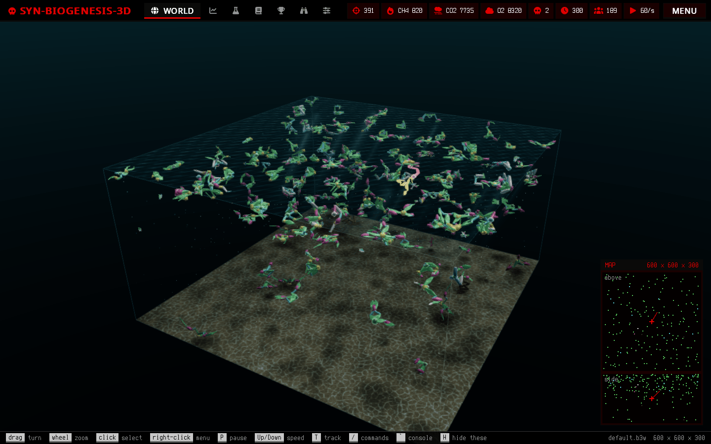 |
| **The slab:** 0.9's floor, 1,000 x 1,000 x 32, every gene flat (`--pitch 0`): the nearest the water comes to the plane | **The pond:** 1,000 x 1,000 x 64, wide and shallow, lit to the floor | **The default box:** 600 x 600 x 300 |
| 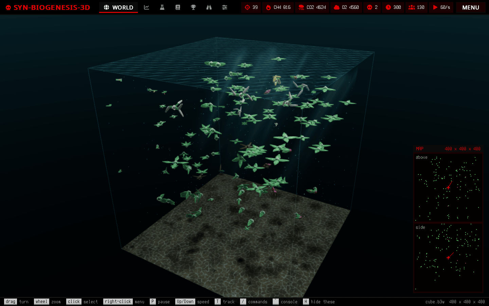 | 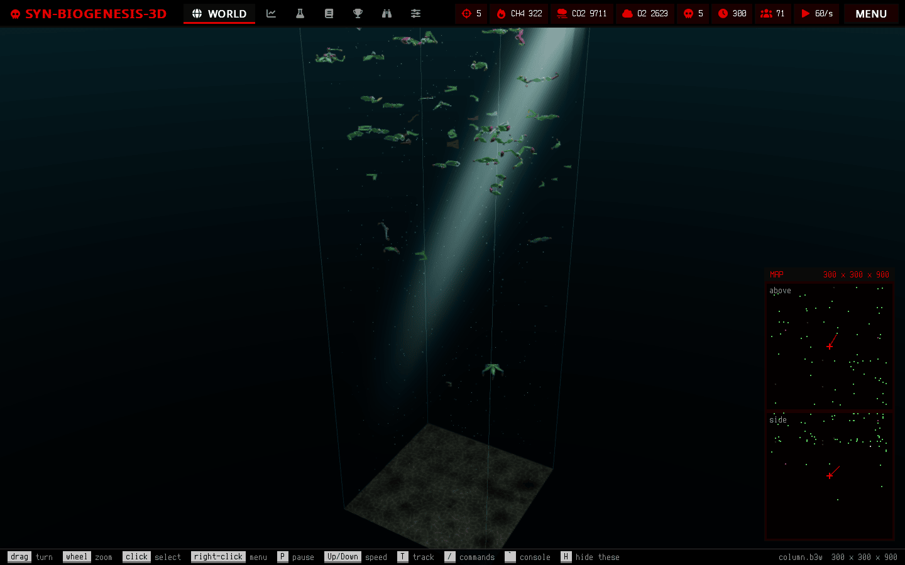 | |
| **The cube:** 400 x 400 x 400, mostly dark | **The column:** 300 x 300 x 900, a little surface over a lot of dark | |

| shape | volume (Mu³) | carbon | light at the floor | alive at time 300 |
|---|---|---|---|---|
| slab, seed 5 | 32 | 5,000 | 88% | 88 |
| pond, seed 17 | 64 | 10,000 | 77% | 139 |
| default box, seed 104 | 108 | 16,875 | 30% | 182 |
| cube, seed 5 | 64 | 10,000 | 20% | 127 |
| column, seed 5 | 81 | 12,656 | 3% | 70 |

The carbon is set by the volume (`co2_density`, 156.25 a million cubic
units: 0.9's 5,000 in its floor 32 deep), so a bigger world holds more
life. The light (shade aside) is the surface's dimmed by e every 250
units. The arena's maps are these shapes too: the default box, four and
nine times its surface, a pond and a cube. Measured on the rules before
the height gene, the cube and the column, mostly dark, went more to the
plants than the default box, and hunting faded in more of them
([docs/ecology](docs/ecology/README.md#the-other-shapes)).

Any size goes: `--size W H D`, or Width, Height and Depth in PARAMETERS. A
world a body thick is the plane again, but with this program's physics.

## Divergence from the 2D

[SYN-BIOGENESIS](https://github.com/syn990/SYN-BIOGENESIS) is Biogenesis
0.9 in C, bit for bit: given the same seed it computes the Java program's
world on every frame. This program began as its rules in a box, keeps
what can be kept, and parts from them wherever depth needs it to. Each
change is in [docs/DESIGN.md](docs/DESIGN.md) with its reason.

| | |
|---|---|
| 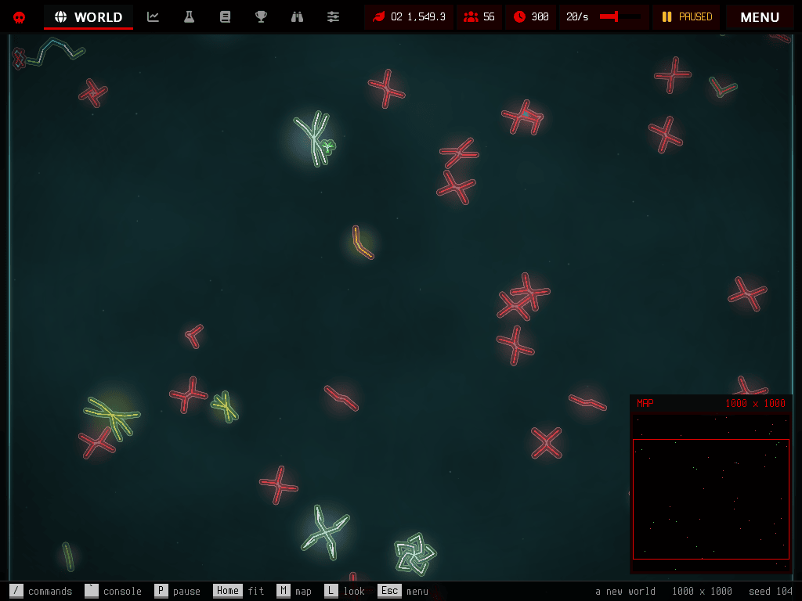 | 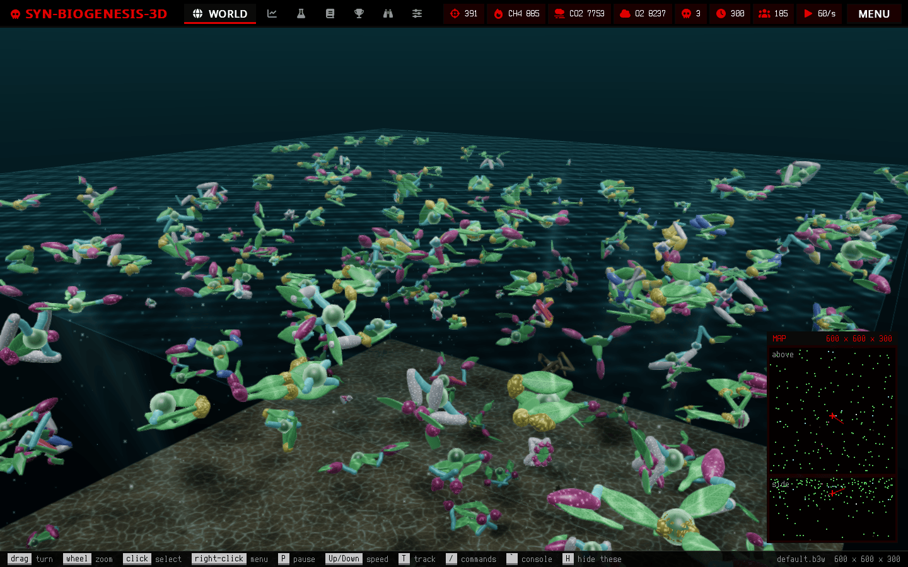 |
| Seed 104 at time 300 on 0.9's plane (SYN-BIOGENESIS, 1,000 x 1,000): 56 organisms | The same seed and time in the water (600 x 600 x 300): 182 |

**Kept, unchanged:**
- every energy rule but light's: red's bite (half its length, a tenth
  breathed out), white's infection, gray's kill, blue's shield, yellow's
  extra children; parents and children never harming each other; upkeep
  of mass / 5000 a frame; ageing (31 units of 256 frames); reproduction at
  40 + 3 x genes x symmetry, at most every 20 frames; corpses decaying at
  0.1 a frame;
- the genetics: 5% mutation per trait, 1 to 100 genes, symmetry 1 to 8,
  mirroring, dispersal, the colour odds, the 16 growth stages;
- the frame: organisms move in birth order, a child born during a frame
  neither moves nor can be touched until the next, and a move that ends
  in a touch is undone;
- the dice: one java.util.Random stream for every decision, with a gene's
  length and turn drawn as 0.9 drew them, so the telescope's algebra
  carries over;
- 0.9's parameters and their defaults, but for the world's size, its
  founders and its CO2.

**Changed:**

| | Biogenesis 0.9 (SYN-BIOGENESIS) | SYN-BIOGENESIS-3D |
|---|---|---|
| the world | a 1,000 x 1,000 plane | a box of water, 600 x 600 x 300, the surface on top |
| proved against | the Java program's own worlds, frame for frame | itself: every build (GCC and clang, optimised or not) makes the same world from the same seed, and the books balance on every frame |
| a gene | a length, a turn and a colour | the same and a bend out of the plane, taking the mutation draw 0.9 made and never used |
| a body | drawn by a turtle on the plane | by a turtle that knows which way is up; a disk, a cone or an orb; capsules `segment_radius` thick |
| its motion | a position, an angle and dx, dy, dtheta | a rigid body: a quaternion, a spin vector and an inertia tensor, turning about its centre of mass |
| light | the same everywhere | from the surface, dimming with depth and in shade; a leaf catches the light it lies across |
| carbon | one CO2 for the world, 5,000 whatever its size | dissolved cell by cell and spreading slowly, by density, so a bigger world holds more |
| the dead | drift and decay | sink, and rot into methane where they lie |
| colours | seven | eight: purple lives on methane, whatever the light |
| moving | cyan's random kicks | sight by the light, smell of the dead, six inherited drives, a float and a height of its own; cyan swims steadily toward the aim |
| children | in the first of 8 directions on the plane with room | in any of 26, from a random one, by a random stride |
| founders | 15, anywhere | 30, at their line's height |
| neighbours | JTS's STRtree | a grid of 32-unit cells |
| maths | the JVM's, reproduced bit for bit | fdlibm's kernels in plain IEEE arithmetic, without FMA, so every platform agrees |

The same 24 seeds, to time 400, on 0.9's plane (by way of SYN-BIOGENESIS)
and in the water:

<picture>
  <source media="(prefers-color-scheme: dark)" srcset="docs/charts/kinds-dark.svg">
  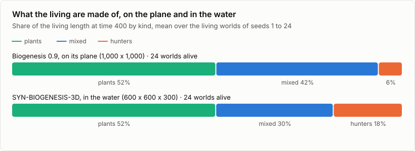
</picture>

<picture>
  <source media="(prefers-color-scheme: dark)" srcset="docs/charts/kinds-time-dark.svg">
  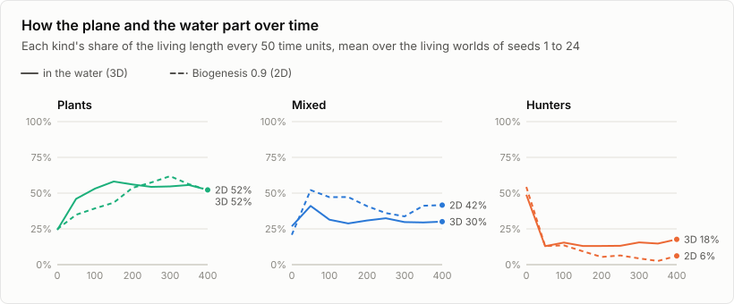
</picture>

An organism is a plant (under a tenth of its length red, gray or white),
mixed (that, and at least 40% of it green or purple) or a hunter (less),
as [docs/ecology](docs/ecology/README.md) classes them. What the charts
show:
- every world of both lives to time 400, and in all 24 of the water's
  hunting lasts to the end (a bite, kill or infection a time unit over
  the last quarter);
- on the plane the hunters fall from 13% of the living length at time 50
  to between 3% and 6% after time 200. In the water they hold between 13%
  and 18% the whole way, three times their share on the plane at the end;
- the plants end level (52% each), but the water's get there at once
  (46% by time 50 against 35%) and stay; the plane's climb to 62% by time
  300 before the mixed take some back;
- the mixed hold more of the plane, from time 50 to the end (42% against
  30% at time 400);
- the plane holds about 65 organisms from time 50 on, all its fixed 5,000
  carbon allows; the water, with 16,875, holds about 200 by time 350.

The first version of this program was 0.9's rules in a box and nothing
else, and there the plants owned the worlds: a median 94% of the living
length in 48 worlds, with hunting lasting in 21
([docs/ecology](docs/ecology/README.md#the-default-worlds)). A plane 1,000
wide keeps hunters and prey close enough to meet; a box of the same rules
does not. The water gives them back a place, near the surface where sight
is longest, while the plants spread through every height (see
[A line: its height](#a-line-its-height)).

## Example beings

Six of 0.9's beings, brought into the water as they are: flat, with the
height and drives their bodies ask for. Each was put in the default box
ten at a time, alone and among 30 random founders, on 8 seeds for 200
time units, and in a duel with each of the others on 4 seeds, ten of each
and nothing else (`tools/charts.py`; every figure is in
[docs/charts/tables.md](docs/charts/tables.md#six-of-09s-beings-in-the-water)).
"Alone" is in how many of 8 worlds its line lives at the end and how many
it numbers then; "among" in how many it outlives random life and its share
of the living then (both medians).

| | | |
|---|---|---|
| 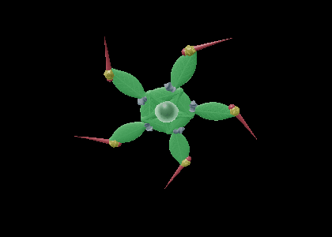 | 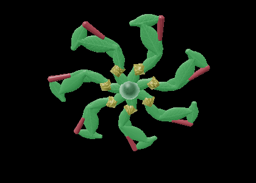 | 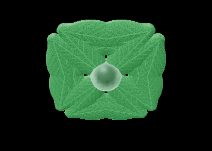 |
| **gallery_4** (Biogenesis's gallery): five arms; green 63%, red 26%, yellow 5%; mixed. Alone 8 of 8 (131); among 8 of 8 (73%); **18 of 20 duels** | **CHAMPION (2)** (a library being): seven arms; green 85%, red 11%, yellow 3%; mixed. Alone 8 of 8 (126); among 8 of 8 (**95%**); 14 of 20 duels | **ultimate**: eight arms, mirrored, four genes, all green; a plant. Alone 8 of 8 (123); among 7 of 8 (92%); 15 of 20 duels |
| 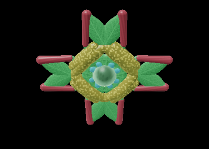 | 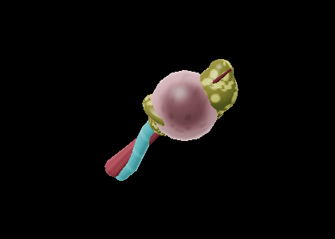 | 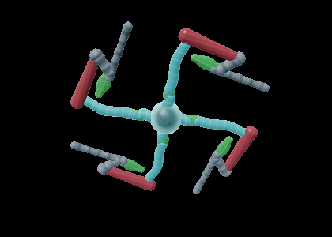 |
| **seed 20908** (forged for 0.9 by SYN-BIOGENESIS's telescope): eight arms, mirrored; green 63%, yellow 16%, red 14%; mixed. Alone 7 of 8 (132); among 5 of 8 (54%); 8 of 20 duels | **gallery_6** (the gallery): one arm and no green; red 38%, cyan 35%, yellow 27%; a hunter. Alone 0 of 8; among 0 of 8; no duel won | **#305** (a library being): four arms; cyan 30%, gray 27%, green 22%; a hunter. Alone 0 of 8; among 0 of 8; no duel won |

What they show:
- the four that live carry 63% green or more, and three of them teeth
  too. gallery_4, a red claw at the end of every green arm, is the
  strongest: it wins 18 of its 20 duels, and it led the arena under the
  earlier rules as well (99% of its rounds there);
- ultimate, all leaves, takes 92% of the living among random founders,
  where under the rules before the height gene it held 13%
  ([docs/ecology](docs/ecology/README.md#09s-beings)). From 0.9 it arrives
  with its height read from its body, leaves high, so its line keeps to the
  bright water from its first frame;
- 0.9's pure hunters do not last. gallery_6, with no green at all, and
  #305 die out alone and among random life in every world, and win no
  duel. Under the earlier rules gallery_6 still lived in 7 of 8 worlds
  among random founders; since then every line keeps to a height of its
  own and cilia swim steadily, and these runs do not say which change
  did it;
- a duel in which both lines die counts for neither, so gallery_6 and #305
  each fought 20 and won none.

Beings born in the water carry more than 0.9's can. The laboratory at the
top of this page holds organism 1520 of seed 104 at time 300, the
heaviest alive then: a blight (what it touches may bear its children
instead of its own) of eight mirrored arms, five genes of cyan, white,
green, purple and green, two of them bent out of the plane. Its line keeps
to 93 deep (a height of 0.69), and its drives pull it toward hunters
(0.92) and the dead (0.91) and away from plants (-0.55).

Any being can be kept (Keep on the card, in the laboratory and on every
being shown), opened in the laboratory, put back in the world, put on the
arena's ladder, or looked up with the telescope's WHERE A BEING LIVES.
FORGE A WINNER and Create a winner make new ones for a seed or for the
world as it is ([The interface](#the-interface)).

## Reading the charts

STATISTICS on the bar is SYN-BIOGENESIS's screen
(`src/syn/history.c`, the screen `src/app/stats.c`): a sample a time unit
since genesis, merged in pairs past 4,096, over the whole run, its last
quarter or its last 5%; hovering reads every chart at once. Below is seed
104 in the default box, watched from genesis to time 300.


- **Population:** from 30 founders to 83 by time 30, back to about 70
  until time 60, 110 by time 100, 150 to 170 from 130 to 240, and over
  200 from 250 (the record, 227, at 284). The corpses stay under 20: the
  dead sink to the floor and rot.
- **Births and deaths** a unit run level with each other once the water
  is full, between 5 and 20.
- **Infections** are next to none until time 200, then climb to between
  30 and 50 a unit: white spreading through the one line left (see Lines
  living).
- **Oxygen** is the energy in the bodies. It climbs from 1,500 (the
  founders' 50 each) to 4,500 by time 30, 7,200 by 100 and about 8,000
  from 130 on, where photosynthesis and breathing balance.
- **Carbon dioxide** falls from 15,375 to 10,600 by time 50 and 8,500 by
  100, then keeps between 7,300 and 8,500. O2, CO2 and CH4 at time 300
  (8,140.5 + 7,777.6 + 956.8) add up to 16,875, the carbon the box began
  with.
- **Methane** comes as soon as the first dead rot (42 at time 5), passes
  1,000 by time 35 and peaks at 1,792 at time 55, then swings between 500
  and 1,400 as purple eats it and it turns back into CO2.
- **Colours of the living:** green holds about half the segments from
  time 30, cyan a fifth (the swimmers), yellow and purple about an eighth
  each. Red and gray, common among the founders, thin to 1% and less;
  white grows late.
- **Generations:** a mean of 19.5 and a highest of 26 at time 300.
- **Lines living:** the founders' 30 lines are about 10 by time 30 and 2
  from about time 100; one of them, LAEXERA, is nearly all that lives (the
  timeline below).

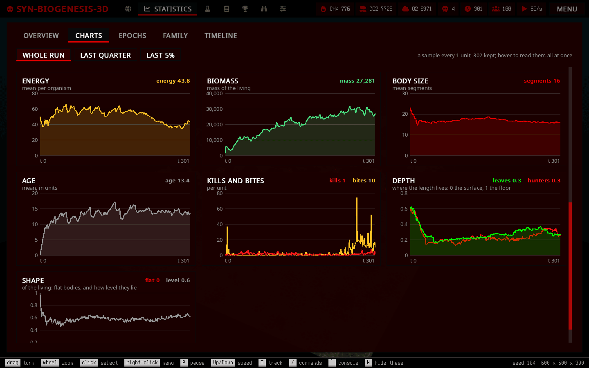

Then 0.9's last four: the energy an organism holds (40 to 60 on average),
the biomass (climbing with the population to about 27,000), the body size
(16 to 18 segments) and the age of the living (about 13 time units of the
31 they may live). And the water's own three:
- **Kills and bites** a unit: a burst among the founders, a few until time
  250, then 7 to 19 bites a unit with bursts to 70;
- **Depth**, where the length lives (0 the surface, 1 the floor), for the
  leaves and the hunters: from their founders' heights (near 0.6) to about
  0.2 by time 20, then sinking slowly to about 0.3 by time 300: life in
  the upper third, the leaves and the hunters together;
- **Shape**, of the living: the share of flat bodies (up to 0.19 in the
  first 30 time units, near 0 from time 50) and how level they lie (0.5
  to 0.65).

| | |
|---|---|
| 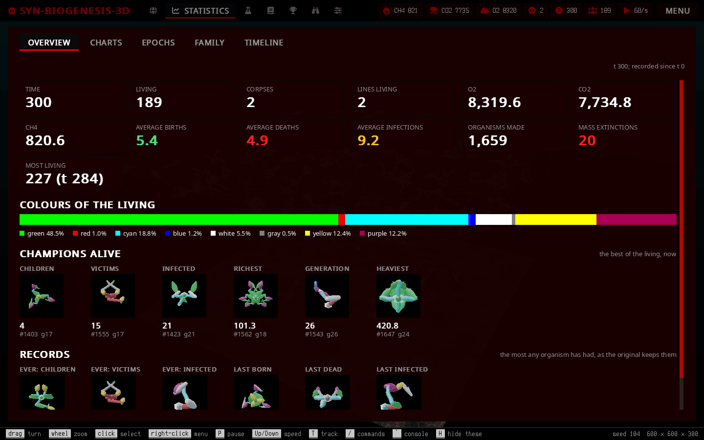 | 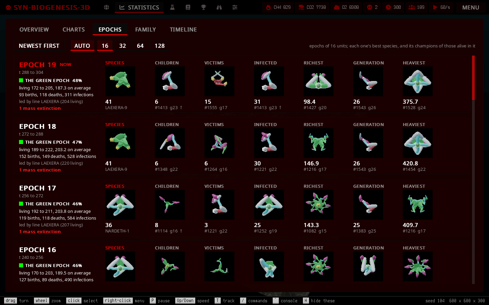 |
| **OVERVIEW:** the world now, 0.9's averages and records (its WorldStatistics, kept by the world and in its file), the colours of the living, the champions alive and the record holders | **EPOCHS:** the run cut into epochs of 16 units, each with its colour (here the green epoch, 48%), its best species and its champions |
| 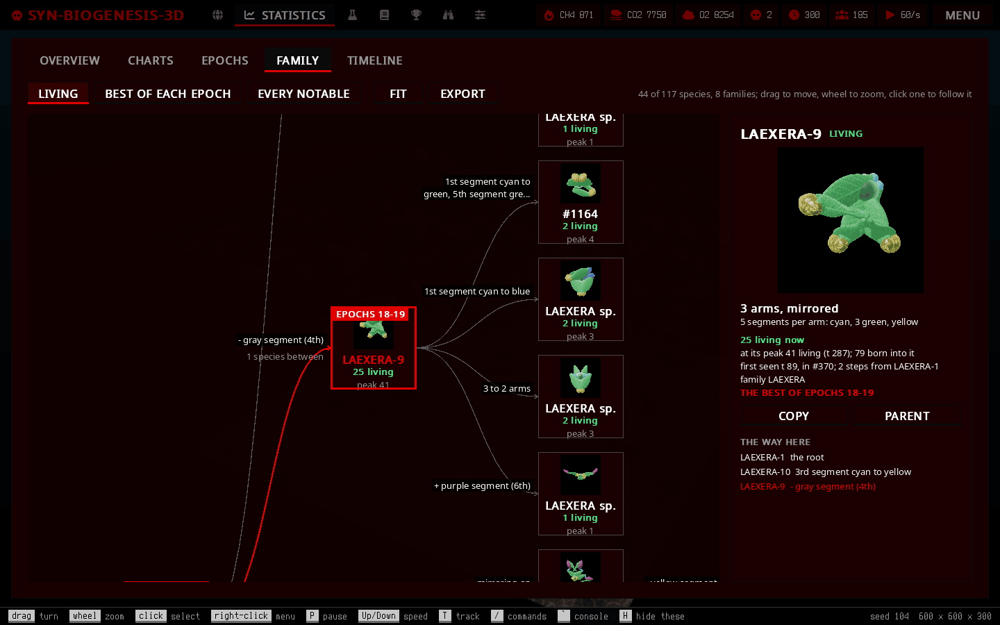 | 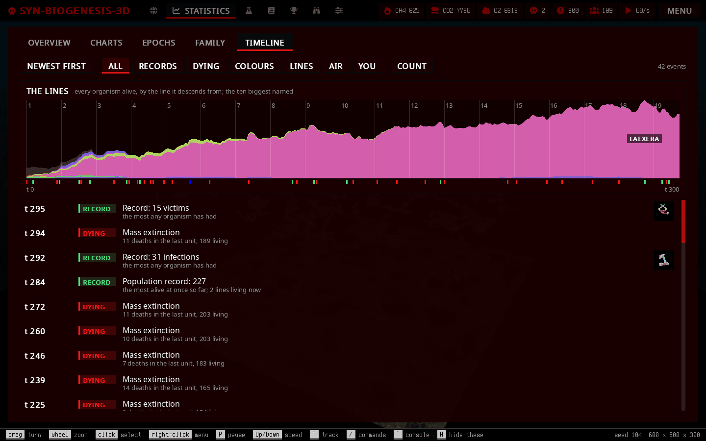 |
| **FAMILY:** the family tree, live, its species named as SYN-BIOGENESIS names them. LAEXERA-9 leads: three arms, mirrored, 25 living, two mutations from the root | **TIMELINE:** the lines' river (LAEXERA's, nearly all of it) and what happened: records, extinctions, colours and lines rising and dying, the air, what you did |

The statistics are saved beside the world (`world.b3w.syn`), so an opened
world's history goes on; the organism card names its species, and Family
opens it in the tree. In the tree EXPORT writes Graphviz's `family.dot`,
every species' picture and code, and the best of each epoch. A being shown
opens in the laboratory on a click (a species in the tree on a double
click); a right click copies it or keeps it. `tests/syn_check` checks that
a world recorded is the world left alone, and that a history saved and
opened again goes on.

## The interface

Over the world is the SYN-OS interface, in the SYN-OS theme your desktop
has on (`~/.config/syn-os/current-theme`), or the one last chosen. Every
screen is SYN-BIOGENESIS's SYN edition's, worked out again for the water
where depth changes what it shows ([docs/PARITY.md](docs/PARITY.md) goes
through them one by one).

| | | |
|---|---|---|
| 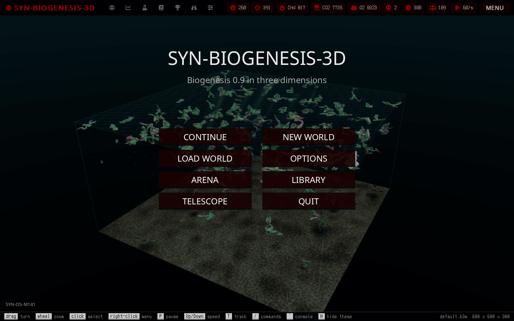 | 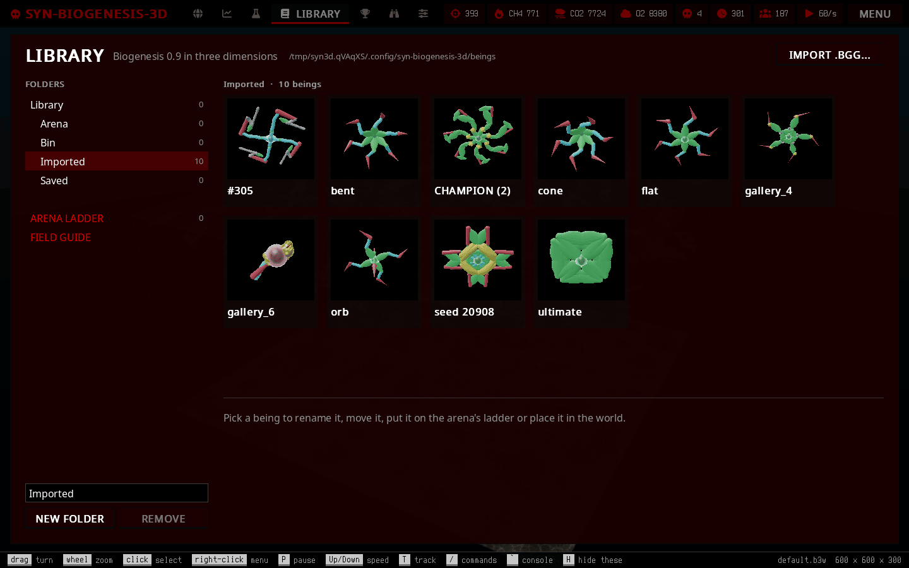 | 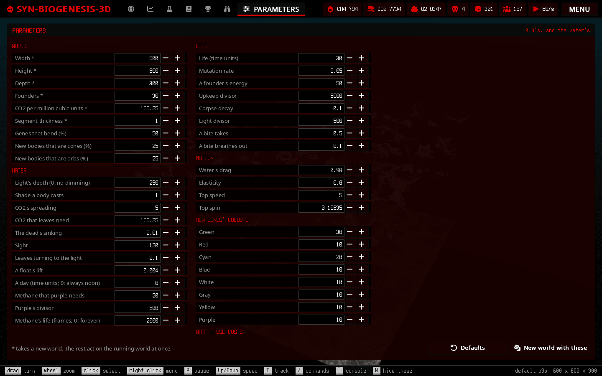 |
| The main menu, over the living world | The library: 0.9's beings and the body plans above | The parameters: 0.9's and the water's |
| 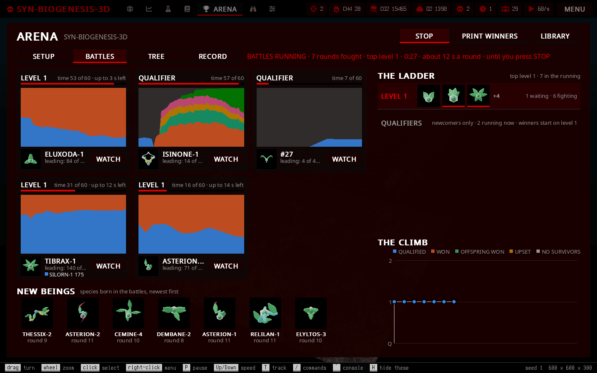 | 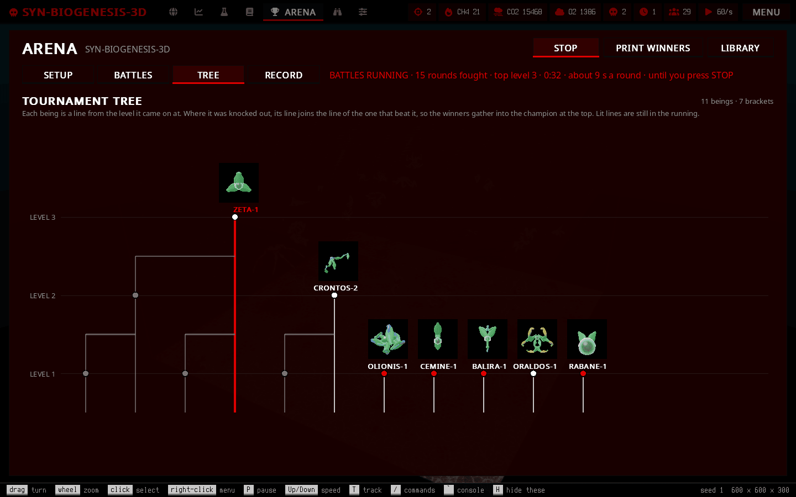 | 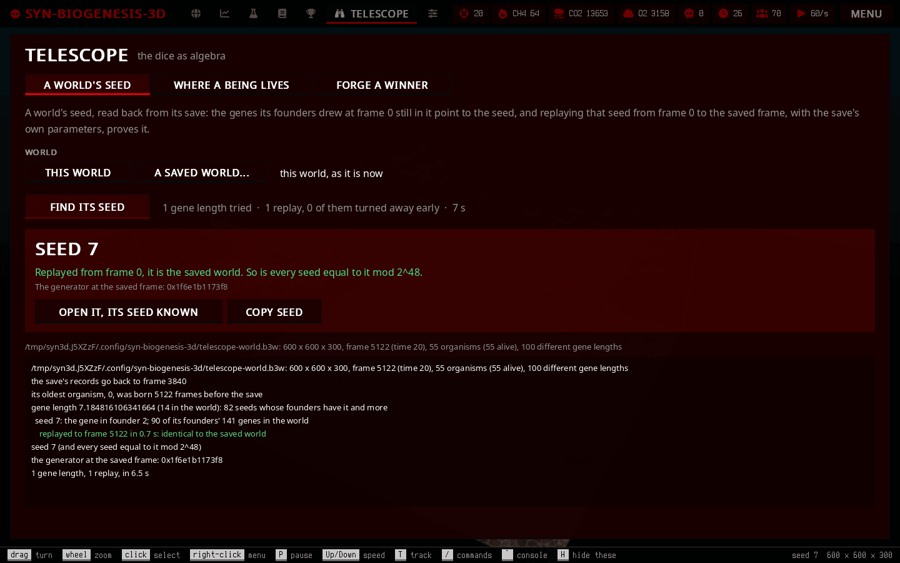 |
| The arena: rounds running on every core | The arena's tree: each being joined to the one that knocked it out | The telescope: seed 7 read back from one founder's gene and proved by one replay, in 6.5 s |

### The world, the bar and the card

- **The bar** (waybar's): the speed, the living, the time, the dead, O2,
  CO2, CH4, kills, the frame rate, the theme, and MENU.
- **The card** (SYN-TREK's target card), for a selected organism:
  - its state and figures, and its life and energy as bars;
  - its depth and the light it has;
  - its kind and description, from SYN-BIOGENESIS's species kinds and book
    of words, with whether it is flat or bent and where its cilia steer it;
  - its body, turning;
  - Feed, Weaken, Kill, Copy, Track, Genes, Family, Keep and Where.
- **The minimap** (`M`, or OPTIONS), SYN-BIOGENESIS's, in two panes: the
  box from above and from the side (its depth), every organism a dot in
  the look's colour of what most of it is, where the camera looks and from
  which way; a click or a drag moves the camera there. It shows while part
  of the box is out of view.
- **Menus** (labwc's), from a right click: on an organism its actions, on
  open water a new organism there (paste, a random one, an import), where
  the pointer's ray crosses the middle of the view.
- **Notifications** (mako's), and the key hints along the bottom.

In the window, bodies are drawn as flesh, each colour its own tissue:
green a veined leaf blade facing the body's up, red a claw tapering to a
hooked point, cyan a slender whip that beats, blue armour plates, white
spotted with spores, gray ridged bone, yellow a sac of eggs, purple a
bladder with bubbles rising in it, a corpse shrivelled; each body thickest
at its hub, where a cell sits, a membrane round a nucleus. Light shows
through thin flesh, and everything is as bright as the water's light where
it is: dim deep down and in the shade. Bites, infections and kills flash
and bloom. The world keeps its own tick, and the picture is drawn between
ticks, so motion stays smooth at any speed. How a body looks is only that:
in the world its segments still touch as capsules `segment_radius` thick.
Detail falls with distance: a body near the eye gets the fine mesh, one
further off a coarse one, and one far away is drawn as lines; what is out
of view is not drawn.

### The looks

| | | | |
|---|---|---|---|
|  | 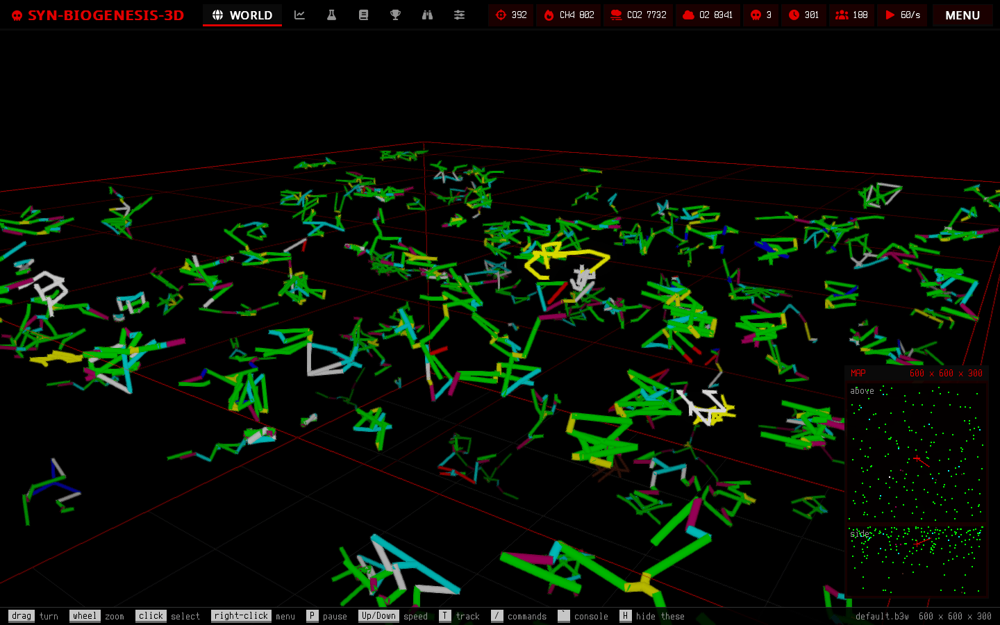 | 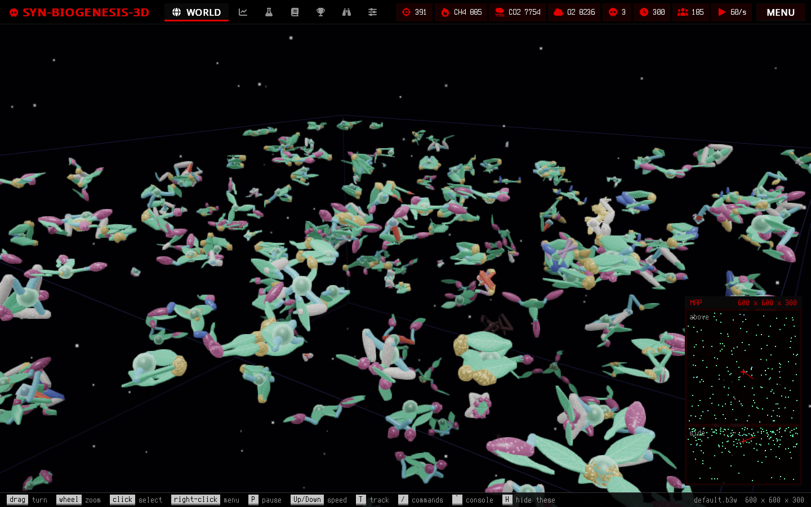 | 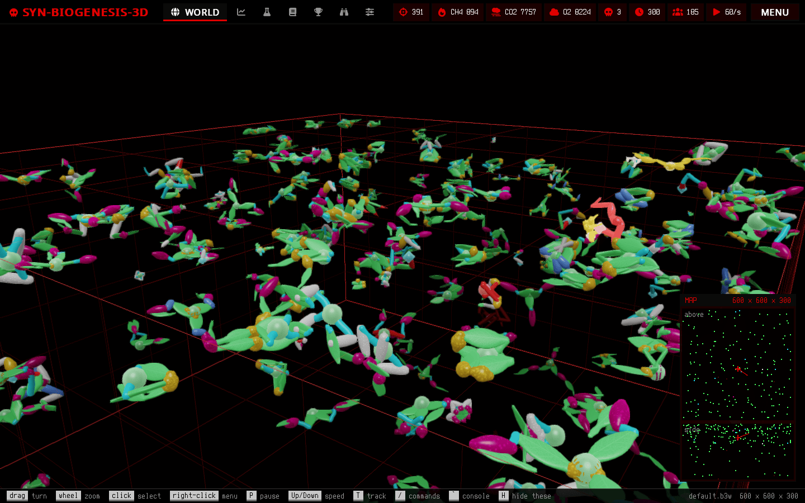 |
| Biological | Classic | Galaxy | Digital (SYN-OS) |

SYN-BIOGENESIS's four looks, drawn in 3D (`L`, or the command list's
VIEW):
- **Biological:** living colours and every tissue's pattern in green-blue
  water: a sediment floor with the caustics' web moving on it and each
  body's shadow, shafts of light from a rippling surface, motes drifting
  down;
- **Classic:** 0.9's colours in the theme's water, every body plain lines,
  nothing moving: the fastest way to watch;
- **Galaxy:** glowing bodies in the dark among stars;
- **Digital:** SYN-OS's colours in a box of red grids.

Every look keeps what the colours mean, and the choice is kept with the
theme. Every being shown on a screen (the laboratory, the library,
statistics, the arena, the telescope) and its saved image are drawn the
same way. **OPTIONS** has fullscreen, the look, the minimap and every
SYN-OS theme by family.

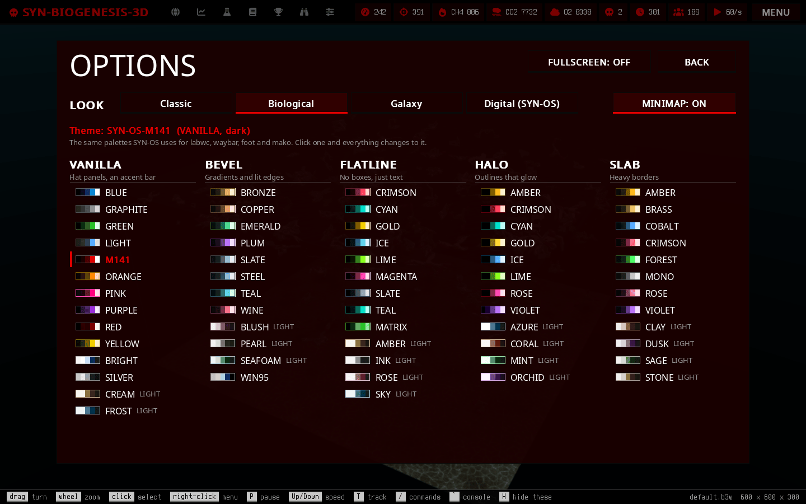

### The laboratory

LABORATORY on the bar, `G` for the organism selected, or a being's menu
(Open in the laboratory): SYN-BIOGENESIS's Genetic Laboratory.
- each gene's length, turn and colour as 0.9's laboratory has them, and
  its bend, out of the flat; typed (click the number) or with - and +;
  genes added, inserted and deleted; the colours with the field guide's
  line on each;
- symmetry, mirror and dispersed children, and how its arms stand (Disk,
  Cone with its tilt, Orb); the segments, the energy to reproduce, the
  life expectancy, its kind, and whether it is flat;
- the height its line keeps to and its drives (light, carbon, plants,
  hunters, the dead, company), or those its body asks for (From its
  body), or none;
- its body as it grows, turning, dragged round and tilted to see the
  bends;
- Copy to clipboard (then Paste in the world), Cancel (esc), Clear,
  Import... a .bgg, and Keep in the library;
- the code is kept while other screens are looked at, until it is copied
  or cancelled.

### The library

SYN-BIOGENESIS's being library (`~/.config/syn-biogenesis-3d/beings`):
- folders, nested as deep as wanted (Saved, Imported, Arena and the Bin to
  begin with), made, renamed and removed; a .bgg put in one by hand is in
  the library too;
- each being drawn, with where it came from and when it was kept; it can
  be renamed, moved, deleted to the Bin (and from the Bin for good, on a
  second click), put on the arena's ladder, put into the world, opened in
  the laboratory (or a double click), copied, or used to start a new
  world with ten of it among the founders;
- IMPORT .BGG copies a file in; Keep on the card, in the laboratory and on
  any being shown puts one in (Saved, or Arena for the arena's);
- SYN-BIOGENESIS's own libraries, of 0.9 beings and of Color Mod's
  (`~/.config/syn-biogenesis/beings/0.9` and `.../colour`), and the
  arena's ladder are shown beside it, read only, Color Mod's beings
  converted as they are read: any of theirs can be kept in this one, and a
  being imported from anywhere is kept as this program's, with what was
  converted written in its note;
- the FIELD GUIDE: what each colour does in the water, and the kinds of
  being.

Every Biogenesis's beings come in. A 0.9 being comes as it was, flat, with
its height and drives read from its body (its leaves high and seeking the
light, its teeth seeking prey); a Color Mod 2.01 being with each of its
colours given the one here that does that job (its methane eater, dark
gray, becomes purple), its branches straightened and its reaction genes
left behind; one from an earlier version of this program keeping to the
height its light drive liked. Nothing is refused for lacking what this
program has.

### The parameters

All of 0.9's, and the water's, typed (click the number; Enter or Tab takes
it, Escape puts it back) or with + and -. Those marked * take a new world;
the rest act at once. They are kept between runs (`parameters` in the
configuration folder). In the console, `params` and `set NAME VALUE`. The
water's are listed in [docs/DESIGN.md](docs/DESIGN.md#new-parameters).

### The arena

SYN-BIOGENESIS's arena, a ladder that winners climb, its rounds run as fast
as they go on several cores at once:
- a qualifier is a world of brand-new beings, and the bloodline that wins
  it goes on the ladder at level 1; from then on beings of a level share a
  world (duels, four-way or eight-way), the winner goes up a level and the
  rest are knocked out;
- its species and bloodlines are named as SYN-BIOGENESIS names them
  (VELORAX-3, the VELORAX line), from a family tree run beside each round;
- SETUP: the world (the default box, four or nine times its surface, a
  pond, a cube, or the parameters' own), the round's length, sudden death,
  how many rounds, how many cores, fighters a round, newcomers; with the
  leaderboard, the ladder, the reigning champion and the new beings;
- BATTLES: each round running, the bloodlines' shares charted as it goes;
  the ladder and the climb;
- TREE: every being joined to the one that knocked it out;
- RECORD: every round ever fought, kept for good, with its bloodline's
  genesis and final beings and what they add up to;
- any round running or recorded can be watched (WATCH): the window makes
  its world again from its parameters, seed and fighters, the very round
  frame for frame (`make test` replays them against the workers' worlds);
- a being shown opens in the laboratory on a click; a right click can also
  copy it or keep it in the library's Arena folder; the library's To the
  arena puts one on the ladder at level 1;
- the ladder and record are kept in the configuration folder
  (`arena.board`, `arena.record`). Without a window: `syn-biogenesis-3d
  --arena` (`--arena --help`), as SYN-BIOGENESIS's.

### The telescope

TELESCOPE on the bar, or the main menu: SYN-BIOGENESIS's dice telescope
worked out again for this program's genesis (`src/syn/telescope.c`,
`src/syn/crack.c`, [docs/crack](docs/crack/README.md)). The dice are
0.9's java.util.Random, so every gene is a place on its seed's stream:
- A WORLD'S SEED: the seed a saved world (or this one, as it is) was made
  from, found from the genes its founders drew at frame 0 and proved by
  replaying that seed to the saved frame with the save's own parameters;
  opened, the world then knows its seed, so Restart begins it again;
- WHERE A BEING LIVES (Where on the card, Where it lives in the menus, the
  library and the arena's record): its genesis ancestor drawn again from
  its genes, every seed whose genesis makes that ancestor, and the being's
  later draws placed in the ancestor's stream (lengths and turns as in
  0.9, and here bends and drives too), so the one seed it lives in is
  found by running the seeds and checking each draw as the stream passes
  it; the arena's recorded rounds that drew its genes; each scene (where a
  gene was drawn, where it is alive, its bloodline alone, gone) opens that
  world at that frame;
- FORGE A WINNER: many seeds' founders made without running their worlds
  and weighed by a fit of which founder's bloodline leads a world
  ([docs/crack](docs/crack/README.md#the-fitness-which-founders-bloodline-leads)),
  the likeliest seeds run, and the being their leading bloodline leads as
  kept, put on the arena's ladder or looked up;
- without a window: `syn-biogenesis-3d --telescope` (`jump`, `seed`,
  `gene`, `world`, `find`, `crack`, `forge`, `basins`, `scene`).

### Create a winner

The command list's NEW LIFE, or the water's menu: a being worked out for
the world as it is, at the place asked for. The world waits while a copy
of it is searched on every core: its commonest codes, their mutations, the
library's beings and the fittest of many random codes, each pasted there
and at the most open places in the water and run on exactly as the world
will go, the best bred on while time is left. The winner is pasted where
it was worked out, and when the calculated time comes the window says
whether the world went as calculated (it does, unless something else is
done to it). Without a window: `syn-biogenesis-3d --winner WORLD.b3w`.

### Commands, the console and files

- **The main menu** over the living world, as SYN-BIOGENESIS opens on:
  CONTINUE, NEW WORLD, LOAD WORLD, OPTIONS, ARENA, LIBRARY, TELESCOPE,
  QUIT (MENU on the bar, or esc with nothing selected).
- **The commands** (`/`, or the bar's glyph): SYN-BIOGENESIS's list,
  wmenu's way, of everything the window does under SYN-OS's root-menu
  headings (WORLD, THE WATER, EVERYONE, NEW LIFE, THE ORGANISM SELECTED,
  VIEW, SCREENS, SYSTEM); typing filters it. Among them 0.9's own: new
  world, open, save as, CO2 up and down (spread through the water), kill
  all, disperse all corpses, a random organism, paste, import a .bgg; for
  the organism selected feed, weaken, force reproduction, rejuvenate,
  kill, copy, export its genes, save its image, keep, revive and disperse
  a corpse.
- **The file browser** (SYN-BIOGENESIS's three columns: the folder above,
  this one with sizes and dates, and a preview that draws a .bgg's being),
  for worlds, beings and pictures.
- **The console** (a drop-down foot, `` ` ``). It takes every command by
  its word (`feed`, `killall`, `co2+`; `help` lists them), and its own:
  `help`, `info`, `get NAME`, `find ID`, `run N`, `co2 + N`, `seed N`,
  `size W H D`, `pitch P`, `import FILE [K]`, `speed N`, `step N`,
  `goto T`, `theme NAME`, `themes`, `select ID`, `genes`, `guide`,
  `colour NAME`, `kind`... `genes` lists the selected organism's genes,
  with how far each one bends, and its drives. `guide` is
  SYN-BIOGENESIS's field guide to the colours, told for the water.

### Keys

The keys are SYN-BIOGENESIS's, with this program's own where it has none:

| key or mouse | does |
|---|---|
| drag / right-drag / wheel | turn the camera / move it / zoom |
| click, right-click | select an organism (and follow it), a menu |
| `p` or space, `.` | pause, one frame while paused |
| up, down | faster, slower (5 to 960 world frames a second, or as fast as it goes) |
| `t`, `f`, del (or `k`), `g` | the selection: track (the camera follows it), feed, kill, its genes in the laboratory |
| `l` | the next look |
| ctrl+`c`, ctrl+`v` | copy the selection's code; paste it under the pointer |
| `+`, `-`, `0`, home | zoom in, out, a world unit a pixel; the whole box again |
| `m` | the minimap |
| `n`, `r` | next seed, restart |
| `s`, ctrl+shift+`s`, ctrl+`o` | save the world, save it as, open one |
| `/`, `` ` ``, `h` | the commands, the console, hide the key hints |
| F11 | fullscreen |
| esc | drop the selection, then the main menu; a screen goes back to the world |
| ctrl+`q` | quit |

## Build and run

C11, SDL2, SDL2_ttf and libepoxy (OpenGL 3.3); cglm comes in `third_party`,
the fonts and SYN-OS themes in `assets`.
`make NO_WINDOW=1` builds the same program without a window, needing only
the C maths library.

```sh
make
./syn-biogenesis-3d                                   # the default world, 600 x 600 x 300
./syn-biogenesis-3d --size 1000 1000 64 --seed 17 --warm 100   # a pond, 100 time units on
./syn-biogenesis-3d --import being.bgg --copies 10    # any Biogenesis's being (0.9's arrive flat)
./syn-biogenesis-3d --headless --seed 42 --frames 51200 --every 10
make test
```

**Saved worlds** (`.b3w`, in `~/.config/syn-biogenesis-3d/worlds`) hold the
parameters, the water's CO2, the dice and every organism. A world loaded
goes on exactly as the one saved would have, frame for frame. Save with
ctrl+`s` or `save [NAME]`; open with `load NAME`, or `--load NAME` on the
command line, headless too (`--headless --load FILE --save FILE`).

`--goto T` runs to time T as fast as it goes and pauses there. `--shot
FILE.ppm` draws one picture and quits (with `--seconds S`, after S
seconds). `SDL_VIDEODRIVER=offscreen` runs the window without showing it.
`--help` lists everything.

`--headless` runs the world without a window. It prints a CSV row per
report:
- the carbon (O2 and the CO2 dissolved);
- births, deaths, kills, infections and bites;
- the living segment length by colour;
- the share of flat codes and how level the bodies lie;
- with `--import` (up to four beings, each its own line), how many living
  descendants each line has (`marked`, `line2`, `line3`, `line4`).

With each row, `--census FILE` writes a row per organism (its founder's
line, where it is, how level it lies, its colours, drives, height and body
plan), and `--profile FILE` the water layer by layer from the surface
down (its CO2, its light and the life in it). `--set NAME VALUE` sets any
parameter.

`make test`:
- checks the trigonometry and exp, and that flat codes build 0.9's bodies
  exactly;
- checks that bent bodies keep their symmetry and mirror images;
- checks the water: light by depth and in shadow, CO2 spreading without
  loss, the dead sinking to the floor, children budding in all 26
  directions alike, and sight that needs light while smell does not;
- balances the carbon and energy books on every frame of five worlds, from
  a slab a body thick to a column 900 deep;
- checks that beings keep every gene and drive through a .bgg, and that a
  world saved and loaded goes on exactly as one that never stopped;
- checks that the statistics' history and family tree leave the world as
  it would have been, and go on across a save;
- checks the telescope: genesis made a founder at a time is the same
  world, every founder of three seeds cracks back to the state that began
  it with its seed in its basin at its slot, and a mutated child finds its
  founder;
- checks that the optimised, unoptimised and (if installed) clang builds
  reach the same state from the same seed;
- replays twenty arena rounds in the window's way and matches the workers'
  worlds.

`tools/film.sh OUT.mp4 [options]` films a world on the CPU, without a GPU.
`make tools/view` builds the CPU window that came before the renderer, for
machines without OpenGL 3.3.

### This page's pictures and charts

Both are made again by tools, as the studies in `docs` are:
- `tools/shots.sh [NAME...]` draws every picture in `docs/screenshots`
  (or those named) off the screen, with a home of its own so your
  settings, library and arena are left alone, in the SYN-OS-M141 theme and
  the Biological look. It makes its worlds headless first, takes the
  beings from the sibling SYN-BIOGENESIS checkout and its library, and the
  picture of 0.9's plane from SYN-BIOGENESIS itself. It needs ImageMagick
  (and uses pngquant if it is installed), and takes about five minutes.
- `tools/charts.py run` runs the same 24 seeds in SYN-BIOGENESIS and in
  the water, and the six beings alone, among random founders and against
  each other (resumable, in `runs/charts`; about 15 minutes on 6 cores);
  `tools/charts.py report` writes `docs/charts`: the charts, light and
  dark, and [tables.md](docs/charts/tables.md) with every number they
  show.

### Windows

The same program builds on Windows 10 and 11 with
[MSYS2](https://www.msys2.org), as SYN-BIOGENESIS does. In its UCRT64 shell:

```sh
pacman -S --needed make mingw-w64-ucrt-x86_64-gcc mingw-w64-ucrt-x86_64-pkgconf \
    mingw-w64-ucrt-x86_64-SDL2 mingw-w64-ucrt-x86_64-SDL2_ttf mingw-w64-ucrt-x86_64-libepoxy
make
make dist
make test
```

`make` builds `syn-biogenesis-3d.exe`, linked statically: SDL and the
libraries it uses are inside it, so it needs no DLL but Windows's own and
runs from Explorer or any shell, with the `assets` folder beside it.
`make dist` puts it, without its debugging information, in
`dist/syn-biogenesis-3d/` with the assets; that folder runs on any 64-bit
Windows 10 or 11 without MSYS2.

It is a window program. Run from Command Prompt or PowerShell, `--help`
and `--headless` write to that console, which does not wait for it; piped
(`| Out-Host`, `| more`), it waits. Saved worlds, kept beings and settings
are in `%APPDATA%\syn-biogenesis-3d`, and the library reads
SYN-BIOGENESIS's beings from `%APPDATA%\syn-biogenesis`, where it keeps
them on Windows. The arena's rounds run as hidden child processes, without
a console each.

## Credits

The rules are Biogenesis's:
- **Biogenesis**, copyright (c) 2006-2010 Joan Queralt Molina:
  <https://biogenesis.sourceforge.net/>
- **Biogenesis 0.9** by MarcoDBAA (2019).

The code comes by way of [SYN-BIOGENESIS](https://github.com/syn990/SYN-BIOGENESIS),
the C rewrite of 0.9. Each source file names what it was grown from.
`src/sim/dmath.c` holds fdlibm's sine, cosine and exponential kernels,
copyright (c) 1993 Sun Microsystems, freely distributable with their
notice. The window, shader loader and lighting pipeline come from
SYN-TREK. The SYN-OS skin and themes, the field guide, the species kinds
and their book of words (`assets/lexicon`, SYN-TREK's lexicon format) come
from SYN-BIOGENESIS, which follows SYN-DEBT. cglm (`third_party/cglm`) is
copyright (c) 2015 Recep Aslantas, under the MIT licence.
- **Fonts:** in `assets/fonts`, each with its licence file:
  - Noto Sans and SYN Terminal (Terminus, cut down and renamed), under the
    SIL Open Font License;
  - Font Awesome Free 7's solid icons, under the SIL Open Font License.
- **The beings** on this page from Biogenesis's gallery (`gallery_4`,
  `gallery_6`) are its website's, by their authors.

This project is not affiliated with the Biogenesis authors.

## Licence

GPL version 2 or later, like Biogenesis (`LICENSE`).
