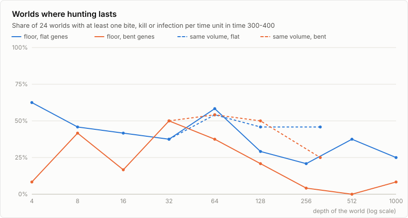
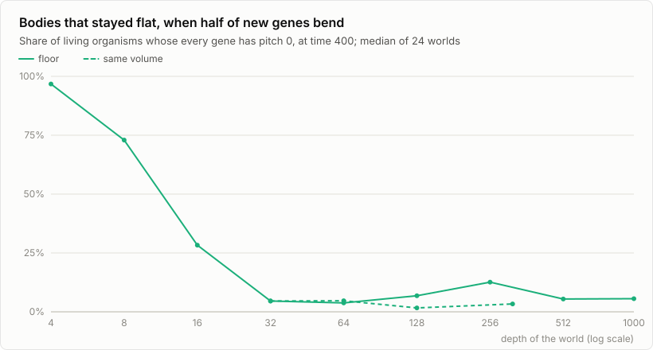

# Does 0.9's life cope with a third dimension?

**Yes, with one condition: the water must stay crowded.**

- **Life survives in every shape**, from a slab one body thick to a cube.
  The plants carry it: in 22 to 24 of every 24 worlds, something is alive
  after 400 time units. The exceptions are thin slabs where genes can bend,
  because bent bodies can hardly be born there: 13 of 24 worlds survive at
  a depth of 4, and 19 of 24 at 16.
- **Hunting thins out as the same carbon spreads through more water.**
  - With 0.9's flat genes, red, gray and white hold on in 15 of 24 worlds
    one body deep, and in 5 to 9 of 24 at a depth of 128 or more.
  - Where genes can bend, hunting almost never lasts at depths of 256 or
    more: 0 to 2 of 24 worlds.
  - Keep the volume and only change the shape, from a slab to a cube, and
    hunting holds on in roughly half the worlds whatever the shape.
  - The thinning is no accident of the dice. A two-sided Fisher test gives
    p = 0.008 for flat genes (15 of 24 worlds one body deep, 5 of 24 at
    256), and p < 0.0001 for bent genes (12 of 24 at 32, 0 of 24 at 512).
- **Thin water selects flat bodies; deep water doesn't care.** Where half
  of all new genes bend:
  - at a depth of 4, 97% of living bodies are flat;
  - at 16, 28% are;
  - from 32 down, 4 to 13% are, about what chance gives for codes of three
    or four genes.
- **0.9's beings mostly cope.** Of 18 beings (your library and the original
  website's gallery), 14 keep a population alive on their own in the slab,
  14 in the default 3D world and 12 in a cube. Four of them win against
  random life in every shape.
  - Hunters with little or no green need prey everywhere.
  - A few slab winners lose their edge in 3D, among them two of your
    champions.

The numbers are medians or counts over 24 worlds per shape (8 per being
test), taken from the last quarter of each run. Hunting is all or nothing in
a world: a predator line either holds, with tens to hundreds of bites per
time unit, or there are next to none. So each world counts as one yes or no.
With 24 worlds, a share has a standard error of about 10 points; read
differences smaller than 20 points as noise.

## How it was measured

`tools/sweep.py run` runs the headless program, and `tools/sweep.py report`
writes `tables.md` and the charts. It takes about 30 minutes on 6 cores.

- **Runs:** 1,440, every one with 0.9's default parameters and 5,000 CO2.
  The world runs start from 15 random founders; the being runs start from
  the being alone or with 15 random founders.
- **Two series of worlds,** each with flat new genes (`--pitch 0`: life as
  0.9 makes it, in a box) and with half of all new genes bent (`--pitch 50`):
  - **floor:** 0.9's 1,000 x 1,000 floor, deepened from 4 to 1,000. The
    same carbon spreads through more and more water.
  - **volume:** the default world's volume (1,000 x 1,000 x 32) kept and
    reshaped, through 707 x 707 x 64 and 500 x 500 x 128, to a cube 318
    wide. The same water in another shape.
- **Length:** 24 seeds each, 400 time units (102,400 frames).
- **Measured** over time 300 to 400:
  - worlds alive at the end;
  - worlds where hunting lasts (at least one bite, kill or infection per
    time unit);
  - organisms;
  - shares of living segment length by colour ("hunters" = red, gray and
    white);
  - the share of flat codes;
  - how level bodies lie (1 = flat to the floor, 0.5 = any way at all).
- **Beings:** each was imported as it is, flat, 10 copies, for 200 time
  units with 8 seeds. They went into three shapes: the slab (1,000 x 1,000
  x 4, flat genes), the default world (1,000 x 1,000 x 32, half of new
  genes bent) and the cube (318 x 318 x 317, the same). Each being was run
  alone and among 15 random founders.

The slab is this program's own stand-in for 2D, not 0.9 itself: its
segments are capsules and its physics is the rigid-body physics of
[DESIGN.md](../DESIGN.md). For scale, genuine 0.9 default worlds
(SYN-BIOGENESIS, seeds 1 to 3) held 26 to 50 organisms at time 400; the
slab's median is 57.

## Life survives

| world | flat genes: alive | bent genes: alive |
|---|---|---|
| 1,000 x 1,000 x 4 | 24 of 24 | 13 of 24 |
| 1,000 x 1,000 x 8 | 22 of 24 | 22 of 24 |
| 1,000 x 1,000 x 16 | 24 of 24 | 19 of 24 |
| 1,000 x 1,000 x 32 | 23 of 24 | 24 of 24 |
| 1,000 x 1,000 x 64 to 1,000 | 24 of 24 each | 22 to 24 of 24 |
| 707 x 707 x 64 to 318 x 318 x 317 | 22 to 24 of 24 | 23 of 24 each |

A slab 4 deep fits only flat bodies. When half of all new genes bend, most
random founders don't fit, too few are born, and 11 of 24 such worlds die
out. Everywhere else, 50 to 82 organisms live on (medians), and plants are
86 to 97% of the living bodies.

## Hunting thins as the water deepens

<picture>
  <source media="(prefers-color-scheme: dark)" srcset="hunting-dark.svg">
  
</picture>

The carbon is fixed (5,000 units), so the population is too: 50 to 80
organisms whatever the size of the world. A deeper floor spreads those
organisms through more water, and hunters, which have to touch their prey,
meet it less. With bent genes it is starker: bent bodies tumble and sprawl,
and from 256 down hunting lasts in 0 to 2 of 24 worlds.

Keeping the volume while changing the shape tells the other half of the
story. From the default slab to a cube of the same volume, hunting lasts in
9 to 13 of 24 worlds with flat genes, and 6 to 13 with bent ones. The bent
cube's 6 is the lowest, but against the default world's 12 a two-sided
Fisher test gives p = 0.14, so 24 worlds can't tell it from chance. How
crowded the water is decides whether hunters live; its shape matters little,
if at all.

## Thin water selects flat bodies

<picture>
  <source media="(prefers-color-scheme: dark)" srcset="flat-dark.svg">
  
</picture>

Where half of all new genes bend, a child whose code bends too far can't be
born in thin water: there is no room for it. So the thinner the world, the
flatter its life. From a depth of 32 there is no sign of that selection.
Six worlds per depth, counted organism by organism, put the flat share at
9% (depth 32), 23% (256) and 15% (1,000). If every gene were flat or bent
by a coin toss, codes of those worlds' sizes (3 to 4 genes) would be 10 to
13% flat. Six worlds hold few separate lines, so that is close enough to
chance.

## Bodies tumble only where they collide

A founder lies level, and a child takes its parent's orientation, so tilt
comes only from collisions and from cilia. With flat genes, how level the
bodies lie is:
- 1.00 one body deep;
- 0.59 at a depth of 32 and 0.52 at 64, where crowded bodies knock each
  other over (0.5 means any orientation at all);
- 0.81 to 1.00 from 128 down, where they rarely meet and stay level.

Bent bodies tumble on their own, because their cilia push off-axis. They
average 0.49 to 0.51 at every depth from 32 down.

## 0.9's beings in 3D

Each being came in flat, 10 copies. "Alone": in how many of 8 worlds its
line was still alive at time 200, and its median population there. "Among":
in how many of 8 worlds its line survived 15 random founders, and its
median share of the living at the end.

| being | make-up | slab, alone | slab, among | default, alone | default, among | cube, alone | cube, among |
|---|---|---|---|---|---|---|---|
| arena: ARAXIRA sp | green 51%, cyan 28%, hunters 21% | 8/8, 40 | 6/8, 100% | 8/8, 36 | 4/8, 50% | 8/8, 40 | 4/8, 4% |
| saved: #305 | hunters 48%, cyan 30%, green 22% | 8/8, 55 | 0/8 | 8/8, 36 | 1/8, 0% | 8/8, 48 | 1/8, 0% |
| saved: CHAMPION (2) | green 85%, red 11% | 2/8 | 8/8, 100% | 2/8 | 1/8, 0% | 1/8 | 3/8, 0% |
| saved: CHAMPION | yellow 35%, green 30%, hunters 25% | 8/8, 47 | 0/8 | 7/8, 48 | 1/8, 0% | 8/8, 55 | 1/8, 0% |
| imported: being-496 | green 69%, blue 26% | 5/8, 36 | 6/8, 100% | 6/8, 40 | 2/8, 0% | 3/8 | 2/8, 0% |
| imported: ultimate-syn1 | green 71%, blue 16%, white 9% | 5/8, 32 | 4/8, 50% | 1/8 | 2/8, 0% | 2/8 | 2/8, 0% |
| imported: ultimate | green 100% | 8/8, 52 | 8/8, 87% | 7/8, 46 | 8/8, 100% | 8/8, 54 | 8/8, 100% |
| forged: seed 15420 | green 74%, cyan 22% | 7/8, 57 | 5/8, 29% | 8/8, 68 | 5/8, 33% | 8/8, 75 | 5/8, 46% |
| forged: seed 20908 | green 63%, yellow 16%, red 14% | 8/8, 36 | 8/8, 100% | 6/8, 28 | 5/8, 100% | 8/8, 44 | 6/8, 100% |
| gallery 1 | gray 39%, red 28%, cyan 21% | 0/8 | 1/8, 0% | 0/8 | 0/8 | 0/8 | 0/8 |
| gallery 2 | white 48%, green 37% | 8/8, 80 | 3/8, 0% | 8/8, 85 | 3/8, 0% | 8/8, 84 | 5/8, 36% |
| gallery 3 | red 50%, green 17% | 8/8, 70 | 4/8, 12% | 8/8, 59 | 0/8 | 8/8, 62 | 3/8, 0% |
| gallery 4 | green 63%, red 26% | 7/8, 64 | 6/8, 100% | 8/8, 53 | 6/8, 100% | 8/8, 58 | 6/8, 100% |
| gallery 5 | blue 57%, green 43% | 8/8, 47 | 2/8, 0% | 8/8, 34 | 4/8, 50% | 7/8, 59 | 3/8, 0% |
| gallery 6 | red 38%, cyan 35%, yellow 27%; no green | 2/8 | 7/8, 39% | 0/8 | 7/8, 46% | 0/8 | 4/8, 15% |
| gallery 7 | green 84%, white 16% | 8/8, 52 | 8/8, 100% | 8/8, 44 | 7/8, 100% | 8/8, 48 | 7/8, 100% |
| gallery 8 | red 50%, green 50% | 8/8, 80 | 4/8, 49% | 8/8, 82 | 7/8, 100% | 8/8, 76 | 6/8, 46% |
| gallery: month | green 79%, blue 19% | 4/8, 24 | 6/8, 100% | 6/8, 36 | 1/8, 0% | 0/8 | 2/8, 0% |

What it shows:

- **Most beings live in 3D as well as in the slab.** "Keeps a population"
  here means alive in at least 5 of 8 worlds. 13 of the 14 that do so alone
  in the slab also do in the default 3D world, and 12 in the cube. Two of
  your beings fall away: ultimate-syn1 (in both) and being-496 (in the
  cube).
- **Four win everywhere:** ultimate (all green), seed 20908, gallery 4 and
  gallery 7. Each survives random life in 5 to 8 worlds of 8 in every shape,
  with a median share of 87 to 100% of the living.
- **Some slab winners lose in 3D.** CHAMPION (2), being-496 and the
  gallery's organism of the month take 100% of the slab in 6 to 8 worlds
  out of 8. In 3D they survive in only 1 to 3 worlds out of 8, with 0%.
  ARAXIRA, your arena's champion, falls from 6 of 8 in the slab to 4 of 8
  with a 4% share in the cube.
- **Hunters need prey in every shape.**
  - Gallery 1 (8% green) never lasts alone.
  - Gallery 6 (no green) lasts alone only in 2 slab worlds of 8, and in
    none in 3D.
  - Among others, gallery 6 survives in 7 of 8 worlds in the slab and the
    default world, and 4 of 8 in the cube.

## What it means for the next steps

- **The default world stays as it is:** 1,000 x 1,000 x 32 with half of new
  genes bending. There, bent bodies take over (5% stay flat), life survives
  in all 24 worlds, and hunting lasts in 12 of them.
- **Deep, sparse worlds are plant worlds.** A deep world for players would
  likely need more carbon, so more organisms, to keep hunters fed. That is
  a parameter, not a new rule, and it hasn't been tested yet.
- **The beings that lose in 3D are the ones worth studying in the
  renderer:** what a 2D champion does wrong once the world has depth.
